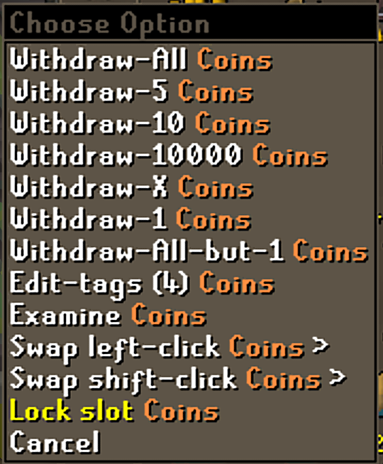
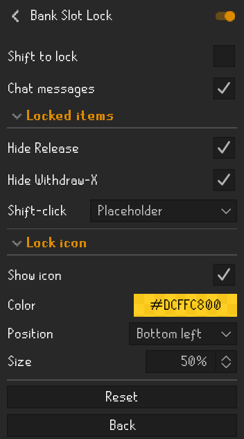

# Bank Slot Lock

A RuneLite plugin that locks chosen bank items so you can't lose their slot by accident.

## Using it

Right-click an item or placeholder in the bank and choose **Lock slot**. A padlock appears on the slot. Do the same and choose **Unlock slot** to remove the lock. Locks are saved per account. Turn on *Shift to lock* to show these options only while Shift is held.

## What a lock does

- **Placeholders on:** the placeholder's **Release** option is hidden (or blocked, if you turn off *Hide Release*). **Release all placeholders** in the bank settings is blocked while any locked item is a placeholder.
- **Placeholders off:** Withdraw-All and Withdraw-X are removed from the menu, and so is your remembered Withdraw-N when N is at least the stack size. Withdraw-1/5/10 and the left-click are blocked when they would empty the slot. Withdraw-All-but-1 always works. Turn off *Hide Withdraw-X* to keep Withdraw-X.

## Shift-click Withdraw-All

When placeholders are off and Shift-clicking a locked item would Withdraw-All (because the bank quantity is set to All, or because Menu Entry Swapper's shift-click is set to Withdraw-All), the Shift-click becomes **Placeholder** instead: it withdraws the whole stack and leaves a placeholder. The *Shift-click* setting under *Locked items* can use **Withdraw-All-but-1** instead, or turn the swap off.

Everything happens client-side: the plugin only removes or cancels menu options. It never sends anything to the game server.

## Settings

## Limits

- Only works in RuneLite with the plugin on. The official and mobile clients don't know about the locks.
- Dragging items around the bank isn't blocked, but dragging only moves a slot. It never deletes one.
