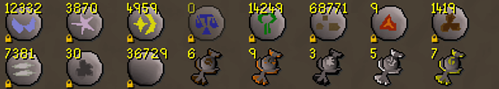

# Bank Slot Lock

Allows you to lock chosen bank items so you can't lose their slot by accident.

To use, right-click an item in your bank and choose **Lock slot**. Actions that would empty the slot without leaving a placeholder are blocked. To remove a lock, choose **Unlock slot**.

